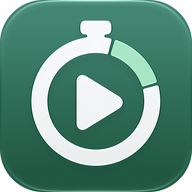
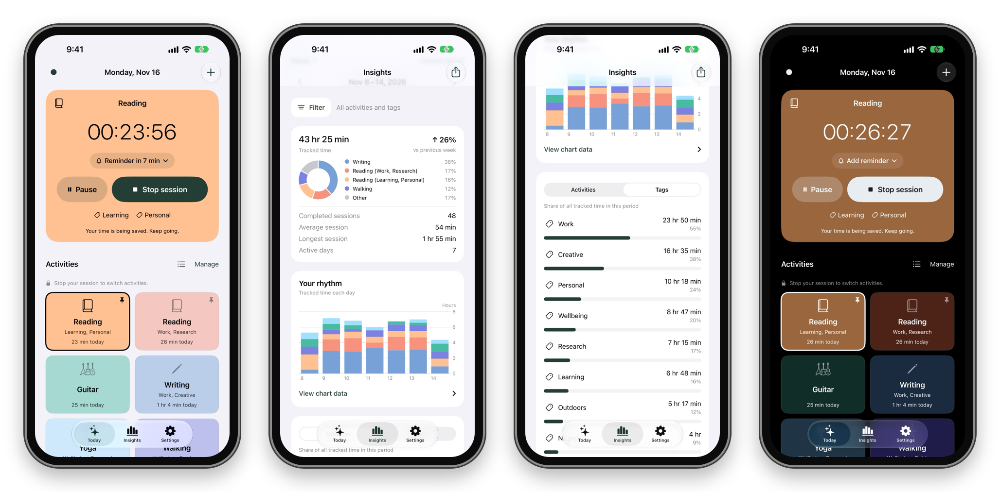

  

# AikaTrail: Time Tracker

Private, offline time tracking made for iPhone, iPhone Duo, and iPad.

AikaTrail helps you see where your time goes without accounts, ads, or clutter. Tap an activity to start, pause for breaks, and stop when you're done. Your history stays on your device.

The app and its [website](https://konstantinsenichev.github.io/AikaTrail/) are available in English and Finnish ([suomeksi](https://konstantinsenichev.github.io/AikaTrail/fi/)).

  

## Why AikaTrail

- **Easy to use**: tap an activity and start. Pause, resume, or stop with one tap.
- **Minimal, no bloat**: no account, no ads, no clutter. Just your time.
- **Tags and groups**: see time by activity, by tag, or by same-name activities together.
- **Insights**: day to all-time totals, trends, and timelines, with filters.
- **Break reminders**: get a nudge after the worked time you set.
- **CSV export**: export any date range for Numbers, Excel, or Google Sheets.
- **Private by design**: fully offline. No accounts, ads, or automatic data uploads.
- **Made for every screen**: optimized for iPhone, iPhone Duo, and iPad.

## Privacy

AikaTrail stores your tracking data on your device and does not send it to the developer. Read the [privacy policy](privacy.html) for details.

## Support

Questions, problems, or ideas: email [konsta.support@gmail.com](mailto:konsta.support@gmail.com). Please include your device model and iOS version.

---

iPhone and iPad are trademarks of Apple Inc. App Store is a service mark of Apple Inc.
